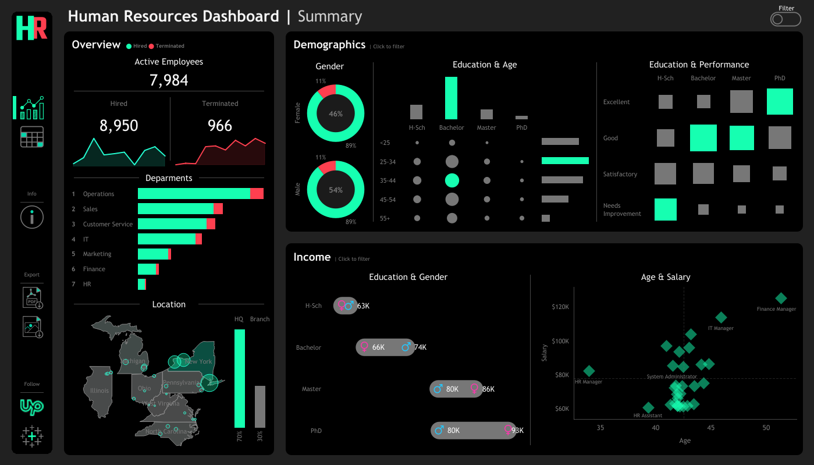
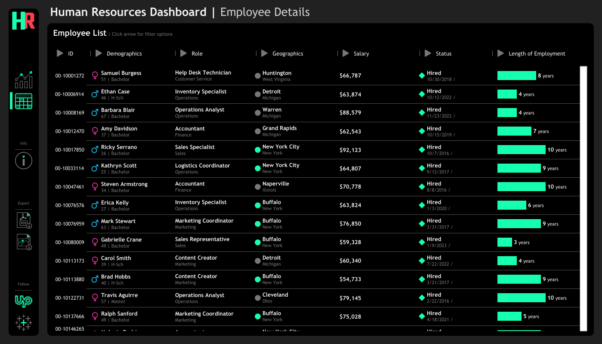

# Human Resources Dashboard

A Tableau portfolio project by **Sharan Rathod** that brings workforce overview, demographics, compensation and employee records into two connected views.

[Portfolio case study](https://sharankumarsrathod12345.github.io/projects/hr-dashboard/) · [Download the Tableau workbook](workbook/HR-Dashboard.twbx) · [Dataset](data/dataset.csv)

## Business question

How can an HR manager review headcount, hiring and terminations, compare workforce groups, and investigate individual employee records in one reporting experience?

The summary view covers workforce trends, departments, locations, gender, education, age, performance and salary. The employee-details view provides a filterable list with employee ID, demographics, role, location, salary, status and length of employment.

## Dataset overview

This is **synthetic portfolio data**, not a real employer's personnel records. The supplied requirements describe a generated dataset with 8,950 employees. Patterns reflect the generation assumptions and do not establish real-world pay gaps or HR outcomes.

| Measure | Verified value |
| --- | ---: |
| Employee records / unique IDs | 8,950 / 8,950 |
| Active: no termination date | 7,984 |
| Terminated: termination date present | 966 |
| Departments | 7 |
| Female / male records | 4,149 / 4,801 |
| HQ records: New York state | 6,270 |

Counts above were checked against the included CSV. Active + terminated reconciles to total records. Terminations divided by all records is not an annual turnover rate.

## Explore the dashboard

1. Download `workbook/HR-Dashboard.twbx` and open it in a compatible Tableau application.
2. Start with **HR | Summary** to review overview, demographics and income.
3. Use the filters and chart selections to explore workforce segments.
4. Switch to **HR | Employee Details** for individual records and column filters.
5. Clear filters to compare your results with the screenshots.

The packaged workbook includes its extract and images. If reconnecting to the CSV, use a **semicolon delimiter**, retain Employee_ID as text, and parse dates as **DD/MM/YYYY**. Blank Termdate means active under the workbook's definition.

## Skills demonstrated

- Tableau calculated fields for headcount, employment status, age, tenure and location.
- Dashboard layout with containers, navigation, show/hide filter controls and export controls.
- Workforce trend charts, department comparisons, maps, demographic views and compensation comparisons.
- Summary-to-record investigation through two dashboard views.
- Requirements and wireframe documentation alongside the finished workbook.

## Definitions and interpretation

| Metric | Workbook logic |
| --- | --- |
| Total hired | Count of Employee_ID across the selected records |
| Total active | Count of Employee_ID with blank Termdate |
| Total terminated | Count of Employee_ID with a nonblank Termdate |
| HQ / Branch | New York state is HQ; all other states are Branch |
| Age | Year difference from Birthdate to TODAY() |
| Length of hire | Year difference from Hiredate to TODAY(), or to Termdate for terminated employees |

Age and tenure are dynamic and may differ from saved screenshots. Tableau year-boundary differences are not exact completed birthday or anniversary calculations. Headcount is based on termination-date presence, not a historical as-of-date model.

## Review notes

The supplied workbook is preserved unchanged. Its Age Groups calculation maps ages below 25 to the label `>25`; that label should read `<25`. Correct this in Tableau before re-exporting the screenshots. The generation prompt mentions overtime and adjusted salary, but the delivered CSV has 14 columns and does not include those separate fields. The original generation script was not supplied and is not recreated here.

This project supports descriptive exploration. It does not establish why employees leave, causal salary differences, or a measured business improvement.

## Repository contents

| Path | Contents |
| --- | --- |
| `workbook/` | Original packaged Tableau workbook |
| `data/` | Original semicolon-delimited CSV |
| `images/` | Summary and employee-details screenshots |
| `docs/requirements.png` | Supplied project requirements and data-generation description |
| `docs/dashboard-wireframe.png` | Layout wireframe |
| `docs/dashboard-wireframe.drawio.png` | Supplied draw.io PNG |

[View requirements](docs/requirements.png) · [View wireframe](docs/dashboard-wireframe.png)
